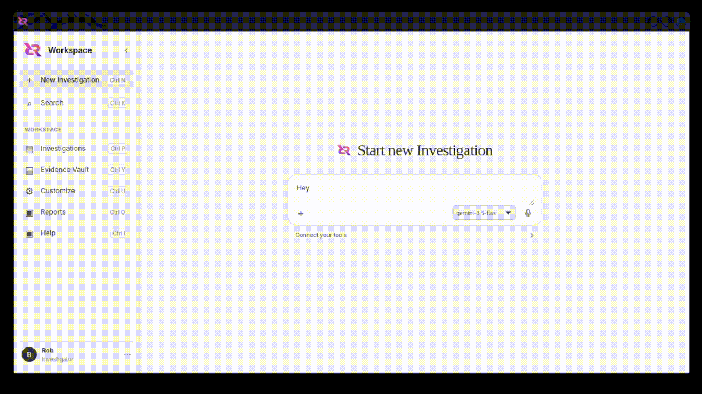

<p align="center">
  
</p>

<h1 align="center">Harness AI effectively to protect children</h1>

<p align="center">
  <b>The intelligent workspace for digital forensics.</b><br>
  Open-weights models. Local tools. Remote APIs. One Workbench.<br>
  Start with local data ingestion. Instantly classify illicit material, execute deep cross-case correlation, and deploy custom tools to generate courtroom-ready reports for global jurisdictions.
</p>

<p align="center">
  <a href="https://github.com/trilliondefense/defendrite/releases/tag/app-v0.1.0"><b>Download</b></a> ·
  <a href="#get-started">Get Started </a> ·
  <a href="./SECURITY.md">Security</a>
</p>

<p align="center">
  <span> Keyboard first </span>·
  <span> Fast and Light </span>·
  <span> Built in Tools </span>·
  <span> Open Weight AI Models</span>·
  <span> Remote MCP Tools </span>
  
</p>

<p align="center"></p>

## Get Started

### Prerequisites

- [Rust](https://rust-lang.org) (Latest stable)
- [Node.js](https://nodejs.org) (v18+ or `pnpm`/`bun`)

### Setup & Run

1. **Install dependencies:**

   ```bash
   cd apps/desktop && npm install
   ```

2. **Launch the development loop:**
   ```bash
   npm run tauri dev
   ```

## Contribute

**Join us in building a safer digital world for children.** </br>
Help us improve our child-safety AI models, refine local media screening engines, or optimize real-time processing pipelines to detect and prevent CSAM and CP. Every contribution directly strengthens open-source technology designed to protect children online.

Get started by reading our [Contribution Guide](CONTRIBUTING.md).
